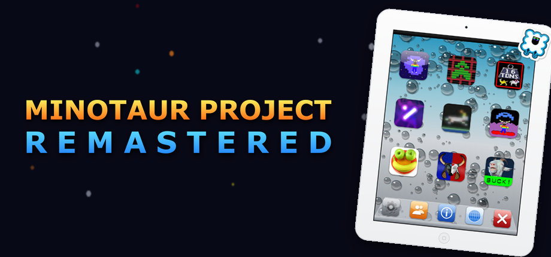

# Minotaur Project Remastered

All nine of Llamasoft's **Minotaur Project** games on a Windows PC, with a
launcher, controller support, high scores, local achievements and a
two-player split-screen mode.

| | | |
|---|---|---|
| Gridrunner | Minotron: 2112 | Minotaur Rescue |
| Five A Day | Deflex | Super Ox Wars |
| Caverns of Minos | Goat Up | Goat Up 2 |

Released with the permission of Llamasoft. The games are © Llamasoft
(Jeff Minter and Ivan Zorzin); this is an unofficial fan project, not made
or supported by Llamasoft.

## Download

Get it from the [Releases](../../releases/latest) page. There are two
versions:

- **MinotaurProjectRemastered-1.2.zip**: everything, games included. Unzip
  and play.
- **MinotaurProjectRemastered-1.2-BringYourOwnGames.zip**: the
  launcher and ports without the games. Put your own decrypted iPad IPAs
  in the `Games` folder beside the launcher (any file names; each game
  finds its own by app ID).

## Start

Unzip the folder anywhere you can write to (not Program Files), then run
`MinotaurProjectRemastered.exe`. Pick a game with the pad or the keyboard.
An Xbox-style controller is recommended.

Needs Windows 10 or 11, 64-bit. Nothing else to install. It also runs on
the Steam Deck under Proton.

## Good to know

- **F11** or **Alt+Enter** switches a game between fullscreen and a
  window.
- **Back** (or **Esc**) leaves a game from its title or pause screen.
  **Start** pauses.
- Saves and high scores live in the `MPR HLE Port` folder, so keep the
  folder together, and back it up to keep your scores.
- Each game's exe in `MPR HLE Port` also runs on its own.
- **2 Players** (in the launcher's dock): two controllers, two iPads, each
  player's game in their half of the screen.
- **Steam:** add `MinotaurProjectRemastered.exe` as a non-Steam game. The
  library art is in `Extras\Steam art`, with a note on where each picture
  goes.

## How it works

The iPad games run in a modified version of
[touchHLE](https://github.com/touchHLE/touchHLE), a high-level emulator for
iPhone OS apps. The fork adds per-game pad controls, presentation
(bezels, glow and starfield bars beside the 4:3 picture), audio fixes and
local high scores.

**The fork is unofficial and not affiliated with or endorsed by the
touchHLE project.** It was written with AI assistance, which touchHLE does
not accept upstream, so please don't report its bugs to touchHLE. Its
source, under the Mozilla Public License 2.0, is at
**[jedeyesniv-art/MinotaurProjectRemastered-touchHLE](https://github.com/jedeyesniv-art/MinotaurProjectRemastered-touchHLE)**.

OpenFeint, Game Center and other online services are switched off. Nothing
connects to the internet.

## Credits

- Games: [Llamasoft](https://llamasoft.co.uk/), Jeff Minter and Ivan Zorzin
- Emulator: [touchHLE](https://github.com/touchHLE/touchHLE) by hikari_no_yume
  and contributors (MPL-2.0)
- Launcher uses [SDL2](https://www.libsdl.org/) (zlib licence)
- Port, launcher and art: jedeyesniv-art
